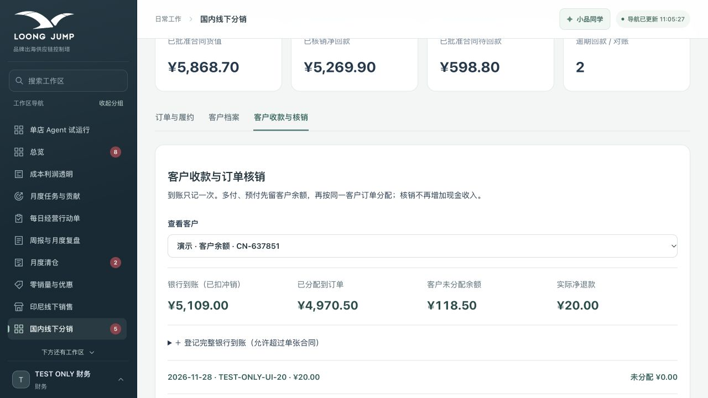

# 国内分销与客户收款修复验收（2026-11-28）

验收范围：隔离本地开发与测试，未修改正式订单、账户或银行记录。2026-11-28 用户已授权发布本次修复；线上结果以对应发布工作流和健康检查版本为准。

## 问题范围

依据《新系统问题-7_供应链订单创建及财务逾期卡点》及用户要求合并修复：供应链订单创建反馈、旧订单作废、客户档案修改、超合同收款卡点、财务逾期及中央财务分类。正式账户归属与历史收款不能根据截图推定或自动改写。

| 原问题 | 本次实现 |
| --- | --- |
| 供应链无法创建或不知道为何失败 | 保留本人客户权限；空客户列表给出建档/负责人核对指引；创建失败提示在页面可见并聚焦，保留已填内容；负责人显示姓名及账号，避免同名账号误选 |
| 错误旧单需要删除 | 无履约、无财务流水的草稿或退回单可自行作废；已送审/已批准但未发货的单据申请取消，由另一位管理员或财务审核；保留历史和凭证，不硬删除 |
| 客户资料填错不能修改 | 本人供应链或管理员可改档案；管理员可交接未来订单负责人；每次保存旧版本及原因，历史订单仍保留原客户快照与责任人 |
| 到账超过合同金额被拦截 | 新增客户独立收款台账，先记银行完整到账，再分配给同一客户已批准订单；超出部分保留客户余额；寄售仅按已确认售出核销 |
| 财务逾期和回款卡点 | 分列已发/已售应收逾期、未发货合同约定付款逾期、寄售到期待对账；供应链/财务可记录跟进事实与复查日期，原合同到期日不被覆盖 |

## 资金闭环

银行实际到账 → 客户未分配余额 → 同一客户订单分配核销 → 重新核对放货条件 → 实发、签收分别留痕。

- 收款只增加一次银行现金；分配只改变订单已核销和客户未分配余额。
- 解除错误分配只回到客户余额，不代表退款。实际退款须另选公司银行凭证、实际日期和流水号，并确认已核对银行事实。
- 取消审核中暂停备货、发货、合同变化及新的分配；真实到账仍可先保留在客户余额。取消不自动退款。
- 付款截图只是待核证据。多张订单提交同一图片会提示核对，财务可把重复待核凭证关联到同一笔银行收款，不重复入账。
- 财务工作台、财务台账及月结汇总分列实际收款、退款、订单核销、客户未分配余额和实际应收；旧版直接核销记录继续保留，不能再重复登记为新收款。
- 版本锁、操作幂等、财务关账、独立审核、同客户校验及银行流水去重均由后端执行。新表及关联字段纳入完整备份恢复。
- 银行凭证沿用该客户订单的私有财务附件入口。本功能登记已发生事实，不连接银行执行转账。

## 合成数据验收

所有操作均在 127.0.0.1 隔离预览进行，出站调用禁用；演示名称均含 TEST ONLY。

1. 供应链创建订单、作废草稿、修改客户联系人和地址；历史订单地址保持原值，修改记录可查。
2. 供应链提交取消申请，页面显示暂停备货发货；切换另一管理员批准，原订单及取消记录仍保留。
3. 收款 5,089.00 元，分配订单 4,970.50 元，余额 118.50 元。解除后余额回到 5,089.00 元，银行收款不变；再次分配仍只记一次银行收入。
4. 重复银行流水被拦截，输入金额、凭证和说明仍保留。另登记合成 20.00 元后再登记等额实际退款：累计银行收款 5,109.00、订单分配 4,970.50、客户余额 118.50、退款 20.00，满足资金恒等关系。
5. 中央财务正确显示部分发货应收 149.70 元；未发货的合同付款逾期单独标记，应收仍为 0。
6. 管理员能查看客户余额及凭证，但没有银行登记/分配/退款按钮；工厂只见履约数量，不见财务金额、余额、凭证。
7. 小品待办中客户余额提醒可直接打开对应客户。390 × 844 窄屏文档宽度仍为 390，余额和明细正常显示。

## 验证结果

- 全套 1,330 项测试：1,326 项首轮通过；4 项 HTTP 服务测试受本机端口沙箱限制，允许仅本地监听后单独重跑 4/4 通过。
- 新增 12 项资金/取消/客户档案测试，覆盖超额到账、跨订单、跨客户拒绝、并发冲突、独立审核、重复凭证、寄售售出、退款与冲销、跨月与关账、完整备份恢复。
- TypeScript 检查、备份清单一致性检查、Node 与 Worker 生产构建通过。
- 最后针对国内分销重新回归 34/34 通过，日志见本地 work/domestic-finance-20261128/final-regression.tap。
- 运行证据：work/domestic-finance-20261128/full-test.log、http-retry.tap、final-build.log。上述文件不进入公开源码。

## 后续上线边界

迁移 0083_domestic_customer_funds.sql 为增量迁移，不补写历史银行到账，不转换真实付款截图，不自动作废真实旧单。发布执行既有备份、迁移及部署验收流程。正式历史单据仍需责任人核对合同、已发数量和真实银行流水，再按新流程处理。

本地合成数据截图：

