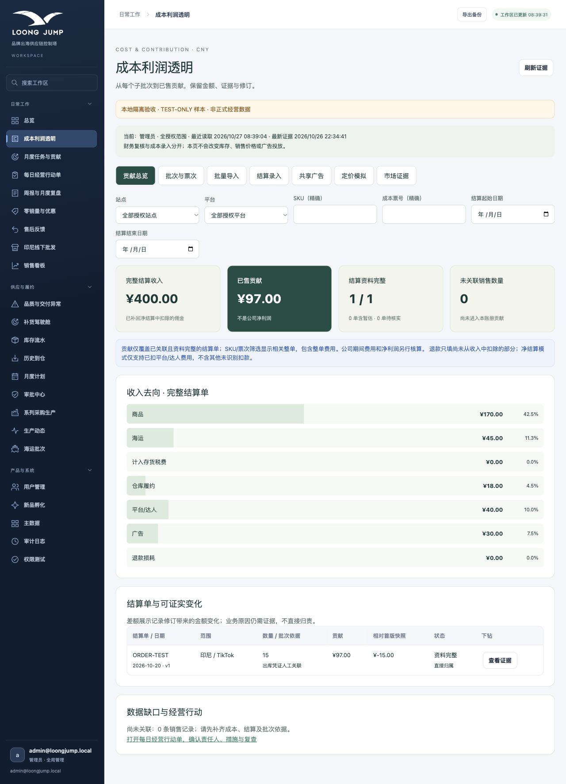
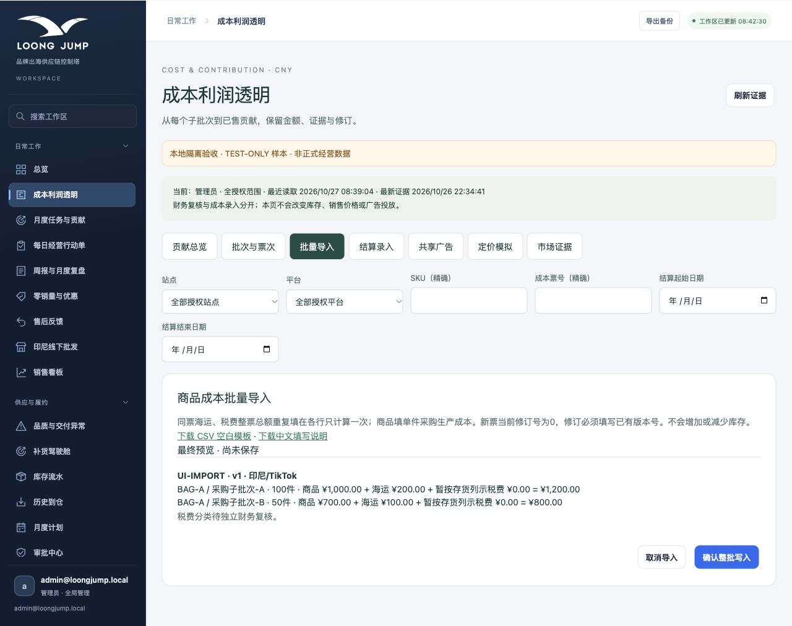

# 成本利润看板本地验收记录

验收日期：2026-10-27。隔离副本：`/Users/tommy/Documents/Codex/2026-10-26/task/Longjump_Admin`。分支：`codex/cost-profit-transparency`；基线：`78cd04d`。本地开发交付，未推送、合并或部署，未写生产数据或扩大真实账号权限；其他 checkout 的未提交修改未触碰。

## 已实现

- 版本化成本账册、独立财务复核、查看/录入/复核后端授权、站点隔离、事务审计、维护锁及备份恢复。
- 同SKU多采购/生产子批次；每票商品原币、固定汇率版本、凭据、状态；海运/税费按件数、总体积或总重量守恒分摊，税费由财务分类。
- CSV/XLSX沿用既有导入组件：模板、字段映射、预览、逐行错误、重复与业务版本冲突、确认提交、整批回滚。取消或失败不写入，成本导入不改库存。
- 关联既有销售记录与批次、仓库每单/每包裹/每件计费、净结算佣金只扣一次、直接/按收入分摊广告、退款损耗、已售与未关联成本余额。
- 看板筛选、证据及修订下钻、收入与费用相对首版快照的差额、完整度和暂估/缺失提示；定价模拟、人工市场证据、既有经营行动单与新品调研入口。

## 最终检查

|检查|结果|
|---|---|
|`node --test tests/cost-profit.test.mjs`|17通过，0失败、0跳过。|
|`node --test tests/*.test.mjs`|370通过，0失败、0跳过；含实际生产Node入口HTTP登录、授权和事务检查。|
|备份迁移清单 `--check` 与 TypeScript `--noEmit`|通过。|
|`node server/build.mjs`|通过。|
|`WRANGLER_LOG_PATH=.wrangler/wrangler.log node node_modules/vinext/dist/cli.js build`|通过；只构建，不部署。|
|全仓 ESLint|未通过：163 errors / 17 warnings；同基线代码逐文件、规则、严重度及诊断首行比较，新增0、移除0。排除了生成目录，绝对路径和行号变化不计为新增诊断。|
|`git diff --check`|通过。|

完整命令日志保存在本隔离副本 `work/verification/`，摘要随代码保存在 `docs/evidence/verification-summary.json`、`lint-comparison.json`、`cost-tests.log`。未使用会尝试自动安装的pnpm入口；直接调用现有已安装工具，未安装或升级依赖。

## 金额夹具与异常保护

子批次A为100件×10，B为50件×14，整票海运300，按件分摊200/100，单位到仓12/16，总额2000。出库A10+B5的已售成本200；海运修订450并复核后已售215、剩余1935，总计2150。旧结算与模拟快照保留。仓库每单3＋每件1共18。净结算360、已扣佣金40、直接广告30，对应收入400、贡献97；不称公司净利润。

另覆盖10元三份为3.33/3.33/3.34、共享广告30按400/600分为12/18、体积/重量不同分摊、USD100按7.00固定700、后续汇率不改写快照、缺失不是零（下钻也显示待核实）、来源销售冲销、超批次数量、运输凭据重复、同业务键金额冲突、两票第二票失败回滚、维护锁、独立复核、无权限零写入、带成本数据的全量备份恢复。

## 浏览器验收与截图

本次实际启动的服务仅监听`127.0.0.1:4317`，使用`work/cost-preview`的TEST-ONLY数据和固定测试身份。正式HTTP鉴权通过独立集成测试验证，没有用该预览身份代替正式权限测试。

- 最终页面显示收入400、贡献97；下钻显示海运当前45、首版30、差额15，并新增销售收入对照行。
- SKU不存在时显示无记录与待核实，不显示虚假盈利。站点/平台筛选及票次修订下钻已于前一轮实际检查；最终行号修复和收入下钻已在本轮重验。
- 错误CSV的未知SKU精确报第3行；整票拒绝，确认按钮禁用。
- 有效CSV预览后取消：`UI-IMPORT`记录数0、错误票0、库存总数205。
- 双击确认后记录数1，再次导入同文件被阻止；错误票仍0，库存仍205。
- 最终浏览器console无error/warn。自动化文件选择曾出现工具超时，改用同一浏览器的原生控件后完成；不计为产品测试失败。
- 390px手机宽度下页面宽度390px，无整页水平溢出；截图包含移动导航。没有跨设备、跨浏览器完整兼容性认证。

截图均为隔离测试样本：

更多证据：`cost-import-error.jpg`、`cost-settlement-evidence.jpg`、`cost-dashboard-mobile.jpg`。旧`cost-dashboard-mobile-kpi.jpg`实际为手机费用分项视图，拍摄于2026-10-26。

## 模板与使用

中文说明：`docs/成本利润透明与导入.md`；UTF-8空白CSV：`docs/templates/商品批次成本导入模板.csv`，网站下载副本`public/templates/cost-ticket-template.csv`；网站说明副本`public/templates/cost-import-guide.txt`。

进入“成本利润透明 → 批量导入”，下载模板，先建立商品SKU，按中文字段填写，再依次进行字段预览、服务端校验与分摊预览、确认整批写入，最后由独立财务账号复核。样本仅放在测试夹具与`work/cost-preview`，空白交付模板不含样本。Excel模板由现有组件生成；最终浏览器路径以CSV验收，未逐种Excel应用验证导出下载行为。

## 未覆盖与上线前另需处理

- 现有系统以SKU日销售汇总为主，本版人工关联真实销售来源与批次，明确凭证关联或计价约定，未实现仓库逐订单自动批次追踪；不自动对接平台逐单结算或批发/寄售收入。
- SKU/票次筛选展示相关整单，避免重复基本费，尚非跨SKU收入及费用精细分摊。未关联余额是成本账册余额，不是实际仓库盘点数量。
- 市场信息仅人工公开证据；无授权抓取、自动排名或公共真实成交价。材质尺寸档次可比性需业务提供依据，超过14天/库存未知降级。
- 诊断为可证实记录差额及人工证据，不自动推断经营因果、追责、调价、投放或发消息；公司期间费用/净利润、税务总账不在本版范围。
- 暂无成本票撤销或数量冲销界面；数量/来源错误需要另行制定受控纠错方案，不可用成本导入改库存。财务权限开通名单需未来部署评审，不在本次真实账号上执行。
- 未测真实成本数据、生产迁移/生产数据库、Cloudflare远程运行、大数据量压测、外部平台对账或完整设备矩阵。Cloudflare构建成功不代表远程运行已验收。
- 已有lint问题以及安装依赖的开发模式RSC重复导出问题仍存在；本次验收使用已成功构建的生产模式。它们未被当作通过，也未通过安装软件绕过。

## 交付状态

本地测试服务已正常退出，并确认4317端口无监听。截图、CSV、中文说明都已保存为真实本地文件。尝试通过官方Library批量交付流程保存6项成果时，主机侧返回`Library prepare_uploads is not available`，在准备上传前停止；未创建Library附件，没有`library_file_id`。此前默认Python版本不足的问题已通过现有Python3.12解决，未安装软件。当前父会话可使用下列本地文件安排附件交付，不应把文件路径当作已收到的附件。
